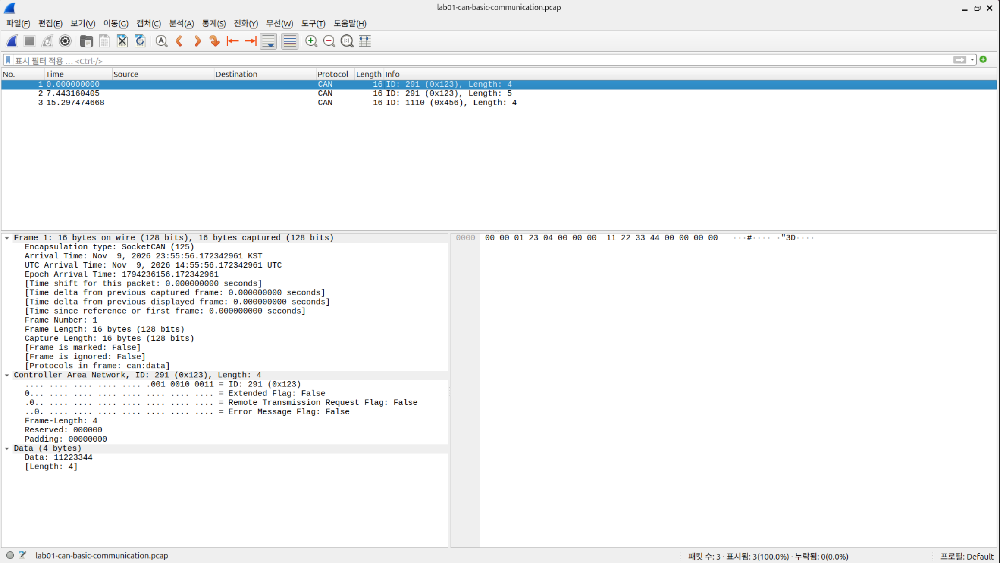
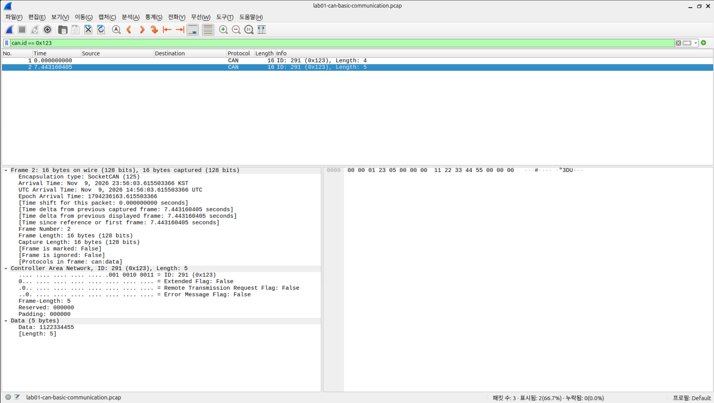
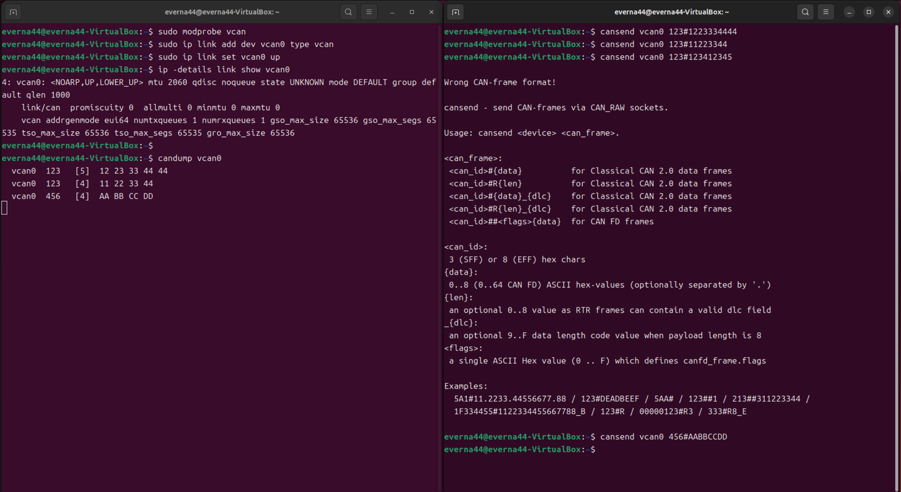

# Lab 01 — CAN Network Analysis

## 실습 목적과 범위

Linux의 SocketCAN과 가상 CAN 인터페이스(`vcan0`)로 프레임을 송수신하고, Wireshark에서 CAN ID, 데이터 길이, 페이로드(Payload)를 분석합니다. CAN ID 표시 필터를 적용하고 원본 캡처와 화면 증적을 대조합니다.

대상은 소프트웨어 가상 CAN 환경입니다. 실제 차량·물리 ECU 시험, 진단 서비스 검증, 취약점 평가 또는 퍼징 실습은 수행 결과에 포함하지 않습니다.

## 환경 구성

| 항목 | 환경 또는 확인 근거 |
|---|---|
| OS | Ubuntu 24.04 — 사용자 실습 기록 기준. 버전 명령 출력은 증적에 없음 |
| 인터페이스 | `vcan0` — 터미널 화면에 생성 명령과 `UP`, `LOWER_UP` 표시 |
| 송수신 | can-utils의 `cansend`, `candump` — 실행 화면 확인 |
| 분석 | Wireshark — CAN 상세 분석 및 표시 필터 화면 확인 |
| 원본 캡처 | PCAP v2.4, little-endian, SocketCAN, 마이크로초 정밀도 |

커널 및 도구의 정확한 버전, 최초 설치 절차는 기존 증적에서 확인되지 않습니다. 아래 설치·재현 명령은 재실행을 위한 절차이며, 문서 작성 시 실제로 재실행한 결과가 아닙니다.

Ubuntu에서 필요한 패키지를 설치하는 예시입니다. 패키지 설치와 가상 인터페이스 설정에는 관리자 권한이 필요합니다.

```bash
sudo apt update
sudo apt install can-utils wireshark
```

Wireshark는 일반 사용자로 실행하고, 캡처가 허용된 사용자 및 `dumpcap` 권한 설정이 필요합니다. 캡처 권한 설정은 배포판의 패키지 설정에 따릅니다.

향후 재현 시 다음 출력도 별도 기록하면 환경을 더 정확히 식별할 수 있습니다.

```bash
cat /etc/os-release
uname -r
dpkg-query -W can-utils wireshark
wireshark --version
```

## 재현 절차

### 1. 가상 CAN 인터페이스 준비

새 실습 세션에서 실행합니다. `vcan0`가 이미 존재하면 `ip link add`는 생략합니다. 기존 인터페이스를 삭제하거나 다른 실습 설정을 덮어쓰지 않습니다.

```bash
sudo modprobe vcan
ip -details link show vcan0
```

조회 결과 인터페이스가 없을 때만 생성합니다.

```bash
sudo ip link add dev vcan0 type vcan
```

인터페이스를 활성화하고 상태를 확인합니다.

```bash
sudo ip link set vcan0 up
ip -details link show vcan0
```

기존 화면에서는 `UP`, `LOWER_UP`, `link/can`, `vcan`을 확인했습니다. 화면의 `state UNKNOWN`만으로 인터페이스 설정 실패라고 판단하지 않습니다.

### 2. 수신 대기

터미널 A에서 실행하고, 송신 완료 후 `Ctrl+C`로 종료합니다.

```bash
candump vcan0
```

### 3. Wireshark 캡처 시작

일반 사용자로 Wireshark를 실행하고 `vcan0`를 선택해 캡처를 시작합니다. 프레임 송신 전에 캡처가 시작되어 있어야 합니다.

```bash
wireshark
```

이후 캡처는 기존 증적을 덮어쓰지 않도록 저장소 밖의 새 경로에 저장합니다. 예: `/tmp/lab01-reproduction.pcap`. 저장 대화상자에서 파일 형식을 **pcap**으로 명시적으로 선택합니다. PCAPNG로 저장했다면 확장자는 `.pcapng`를 사용합니다. 확장자 변경만으로 파일 형식이 변환되지는 않습니다.

### 4. 프레임 송신

터미널 B에서 다음을 순서대로 실행합니다. **기존 PCAP의 ID·Payload·순서를 재현하기 위한 명령**이며, 터미널 스크린샷에 찍힌 명령 전체를 전사한 것은 아닙니다.

```bash
cansend vcan0 123#11223344
cansend vcan0 123#1122334455
cansend vcan0 456#AABBCCDD
```

`candump`에서 기대하는 ID, 길이, Payload는 다음과 같습니다. 이는 새 실행에서 관찰한 결과가 아닌 비교 기준입니다.

```text
vcan0  123  [4]  11 22 33 44
vcan0  123  [5]  11 22 33 44 55
vcan0  456  [4]  AA BB CC DD
```

실행 간격과 스케줄링에 따라 상대 시간은 달라집니다. 기존 캡처의 시간 간격을 정확히 재생하는 절차가 아닙니다. 다른 송신 프로그램이 실행 중이면 추가 프레임이 보일 수 있습니다.

### 5. 분석 및 비교

캡처를 중지하고 저장한 뒤 ID, 데이터 길이, Payload를 아래 원본 분석 표와 비교합니다. 표시 필터(Display filter)에 다음을 입력합니다.

```text
can.id == 0x123
```

위 세 프레임만 캡처했다면 2개가 표시되어야 합니다. 표시 필터는 화면에 보여줄 패킷을 선택하며 원본 캡처에서 다른 패킷을 삭제하지 않습니다.

기존 원본을 다시 분석하려면 저장소 루트에서 실행합니다.

```bash
wireshark labs/01-can-network-analysis/captures/lab01-can-basic-communication.pcap
```

`file`, `capinfos`, `sha256sum`이 설치된 환경에서는 다음으로 형식과 무결성을 확인할 수 있습니다.

```bash
file labs/01-can-network-analysis/captures/lab01-can-basic-communication.pcap
capinfos labs/01-can-network-analysis/captures/lab01-can-basic-communication.pcap
sha256sum labs/01-can-network-analysis/captures/lab01-can-basic-communication.pcap
```

## 실제 PCAP 분석 결과

[원본 캡처: lab01-can-basic-communication.pcap](captures/lab01-can-basic-communication.pcap)

파일 헤더, `capinfos` 메타데이터 및 각 패킷의 원시 바이트를 확인한 결과입니다.

| 항목 | 확인 값 |
|---|---|
| 실제 형식 | PCAP v2.4, little-endian（PCAPNG 아님） |
| 캡슐화(Encapsulation) | SocketCAN |
| 타임스탬프 정밀도 | 마이크로초(µs) |
| 파일 크기 | 120바이트 |
| 패킷 수 | 3개 |
| 패킷 데이터 합계 | 48바이트 — SocketCAN 레코드 16바이트 × 3 |
| 첫 패킷부터 마지막 패킷까지 | 15.297475초 |
| 캡처 길이 상한(Snaplen) | 262144바이트 |

SHA-256:

```text
3935292f8ebc4c0870c5158504049768b5eb17b7b7bf5f64dc37d1f94f67d68a
```

상대 시간은 첫 패킷의 저장된 타임스탬프를 기준으로 계산했습니다.

| 프레임 | 상대 시간(초) | CAN ID(16진수) | CAN ID(10진수) | 데이터 길이 | Payload |
|---|---:|---|---:|---:|---|
| 1 | 0.000000 | `0x123` | 291 | 4바이트 | `11 22 33 44` |
| 2 | 7.443161 | `0x123` | 291 | 5바이트 | `11 22 33 44 55` |
| 3 | 15.297475 | `0x456` | 1110 | 4바이트 | `AA BB CC DD` |

세 프레임의 Extended Frame, Remote Transmission Request(RTR), Error 플래그는 모두 꺼져 있습니다. 캡처에서 표준 형식(Standard format)의 Classical CAN 데이터 프레임 3개를 확인했습니다. 각 레코드의 캡처 길이와 원래 길이는 모두 16바이트입니다.

## CAN 프레임 읽기

`cansend vcan0 123#11223344`를 예로 들면 다음과 같습니다.

| 요소 | 의미 |
|---|---|
| `vcan0` | 송신할 가상 CAN 인터페이스 |
| `123` | 16진수 CAN ID `0x123` |
| `#` | 이 명령에서 CAN ID와 데이터의 구분자 |
| `11223344` | 4바이트 Payload: `11 22 33 44` |

CAN ID는 메시지 식별과 중재(Arbitration)에 사용되며, 이 실습에서 특정 ECU 주소나 차량 신호로 정의하지 않았습니다. Payload를 속도·RPM 등의 물리량으로 해석할 신호 정의(DBC)도 없습니다.

Wireshark 패킷 목록의 `Length: 16`은 저장된 SocketCAN 레코드 길이입니다. CAN 상세 정보의 데이터 길이 4 또는 5바이트와 다릅니다. 16바이트를 물리 CAN 버스에서 전송된 전체 프레임의 바이트 수로 해석하면 안 됩니다. `vcan` 실습은 물리 버스의 비트 타이밍, ACK, CRC 또는 실제 중재 동작을 검증하지 않습니다.

## 스크린샷과 증적 대조

### CAN 프레임 분석



전체 3개 프레임 목록과 첫 프레임의 ID `0x123`, 데이터 길이 4, Payload `11223344`가 보입니다.

### CAN ID 필터



`can.id == 0x123` 적용 후 3개 중 2개가 표시됩니다. 선택된 두 번째 프레임에는 길이 5와 Payload `1122334455`가 보입니다.

### 가상 CAN 송수신



`vcan0` 구성 명령, 인터페이스 상태, 송수신 명령 및 수신 출력이 보입니다. 다음 차이 때문에 이 화면과 PCAP을 동일 실행의 기록으로 단정하지 않습니다.

| 항목 | 터미널 화면 | PCAP |
|---|---|---|
| 첫 번째 수신 프레임 | `0x123`, 5바이트, `12 23 33 44 44` | `0x123`, 4바이트, `11 22 33 44` |
| `0x123`의 5바이트 Payload | `12 23 33 44 44` | `11 22 33 44 55` |

Wireshark 스크린샷에는 나노초 자리까지 시간이 표시되지만, 현재 원본 PCAP의 저장 정밀도는 마이크로초입니다. 본문의 상대 시간은 원본 파일을 기준으로 작성했으며, 정밀도 차이의 원인은 확인되지 않았습니다.

화면에는 `cansend vcan0 123#1234123412345` 입력 뒤 `Wrong CAN-frame format!`도 보입니다. 데이터가 홀수 개의 16진수 문자로 입력된 사례입니다. 이는 `cansend`의 입력 형식 오류 관찰이며, 비정상 CAN 프레임이 전송되었거나 ECU가 이를 거부했다는 증거가 아닙니다.

## 학습 내용 및 한계

- SocketCAN의 가상 인터페이스 구성과 `cansend` / `candump` 사용 흐름을 확인했습니다.
- 동일 CAN ID에서도 서로 다른 길이와 Payload가 관찰될 수 있음을 확인했습니다. 유효한 메시지인지는 별도의 프로토콜 정의가 있어야 판단할 수 있습니다.
- Wireshark에서 CAN ID, 데이터 길이, Payload와 플래그를 확인하고 특정 ID로 표시를 제한했습니다.
- 원본 패킷, 스크린샷, 파일 형식과 타임스탬프 정밀도를 구분해 증적을 검토했습니다.

현재 증적의 한계는 다음과 같습니다.

- OS 및 도구 버전 출력과 전체 실행 로그가 없어 환경을 완전히 고정할 수 없습니다.
- PCAP에서 SocketCAN 캡슐화는 확인되지만 인터페이스 이름 `vcan0`는 확인되지 않습니다. 해당 이름은 터미널 화면에서 확인됩니다.
- 캡처된 프레임은 3개입니다. 전체 통신의 무손실, 성능, 주기성, 응답 시간 또는 안정성을 판정할 수 없습니다.
- 오류 플래그가 꺼진 3개 프레임을 확인한 사실로 전체 실습 중 오류가 없었다고 단정할 수 없습니다.
- 터미널 화면과 PCAP의 일부 데이터가 달라 일대일 실행 대응이 확인되지 않습니다.
- 문서에 제시한 설치·재현 절차는 이번 문서 작성 과정에서 실행하지 않았습니다.
- 실제 차량·물리 ECU, CAN FD, ISO-TP, UDS, 보안 기능, 취약점은 검증하지 않았습니다.

## 다음 단계: Lab 02 계획

소프트웨어 가상 ECU의 요청·응답 규칙을 먼저 정의하고 정상 요청에 대한 응답, 잘못된 길이와 미지원 ID에 대한 처리 방식을 구현할 계획입니다. 송신 입력, 기대 결과, 실제 로그와 캡처를 함께 남겨 후속 퍼징의 판정 기준으로 사용할 예정입니다.

현재 Lab 02 코드나 실행 결과는 없습니다. Lab 01의 `0x123`과 `0x456` 사이에 요청·응답 관계가 검증된 것은 아닙니다.

[프로젝트 개요로 돌아가기](../../README.md)
