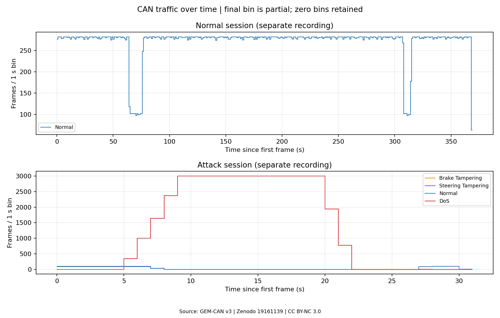
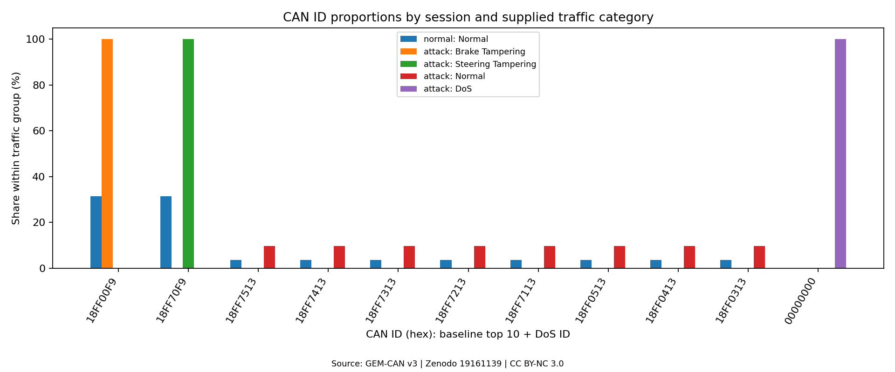

# Lab 03 — GEM-CAN 공개 CAN 데이터 분석

## 실습 목적과 데이터셋

자동차 CAN 통신을 학습하면서 공개 데이터셋을 직접 읽고, 프레임 구조와 정상·공격 트래픽의 차이를 살펴본 실습입니다. GEM-CAN v3의 정상 주행·공격 세션 CSV를 분석해 CAN ID 분포, 시간별 기록 수, DoS 구간의 메시지 간격을 정리했습니다.

GEM-CAN은 GEM e6 차량에서 수집한 CAN 데이터와 공격 레이블을 제공하는 공개 데이터셋입니다. 기본 분석과 [DoS 상세 분석](dos-deep-dive/README.md)을 완료했으며, 아래 수치는 저장된 분석 결과를 기준으로 합니다.

## 데이터 규모와 공격 유형

| 항목 | 정상 주행 CSV | 공격 세션 CSV |
|---|---:|---:|
| 전체 기록 | 100,000 | 43,444 |
| 정상 (`label=0`) | 100,000 | 1,039 |
| 공격 (`label=1`) | 0 | 42,405 |
| 고유 CAN ID | 13 | 14 |
| 관측 시간 (첫~마지막, 초) | 368.230143 | 30.052250 |
| DLC | 모두 8 | 모두 8 |

총 143,444행이며, 공격 세션의 구성은 다음과 같습니다. 공격 유형은 제공자의 레이블을 사용했습니다.

| 유형 | 기록 수 | 공격 세션 내 비율 | CAN ID |
|---|---:|---:|---|
| Normal | 1,039 | 2.39% | 11종 |
| DoS | 41,080 | 94.56% | `00000000` |
| Brake Tampering | 663 | 1.53% | `18FF00F9` |
| Steering Tampering | 662 | 1.52% | `18FF70F9` |

공식 README의 공격 전체·정상 건수는 실제 CSV·TRC보다 각각 1행 작습니다. 이 문서에는 실제 파일에서 확인한 43,444행·1,039행을 사용했습니다.

## CAN 데이터 구조

정상 파일은 `GEM_Normal_Driving_Raw_Labeled.csv`, 공격 파일은 `GEM_Attack_Scenario_Raw_Labeled.csv`입니다.

| CSV 컬럼 | 의미와 확인 내용 |
|---|---|
| `arbitration_id` | CAN ID. 접두사 없는 16진수이며 그래프에서는 `00000000`처럼 8자리로 표시 |
| `dlc` | 데이터 길이. 모든 행이 8이며 Payload 바이트 수와 일치 |
| `data0`~`data7` | Payload 8바이트. 각 값을 16진수로 읽음 |
| `timestamp` | 수집 도구의 시간 offset. 배포 CSV는 밀리초(ms), 분석 시 1,000으로 나누어 초로 변환 |
| `label` | 제공자의 정상(0)·공격(1) 주석 |
| `Attack_Type` | 공격 세션에만 있는 유형 주석. 정상 주행 파일은 전체 `label=0` 확인 후 Normal로 분류 |

Timestamp는 CAN 프레임 내부 필드가 아닌 수집 시각입니다. 공식 README의 초 단위 설명과 달리, CSV의 시간 값은 정상 PCAN JSON·공격 TRC의 ms 값과 전 행 일치했습니다. CAN ID와 Payload는 바이트 수준에서 비교했습니다.

## 정상·DoS 트래픽 비교

| 비교 항목 | 정상 주행 | 공격 세션 |
|---|---:|---:|
| 전체 기록 수 / 관측 시간 (기록/초) | 271.569 | 1,445.616 |
| 완전 중복 (첫 출현 제외) | 0 | 21,363 |
| 원본 순서에서 timestamp 역행 | 0 | 79 |

- 정상 주행에서는 `18FF00F9`, `18FF70F9`가 각각 31,383행으로 가장 많았습니다.
- DoS 41,080행은 모두 ID `00000000`, Payload `00 00 00 00 00 00 00 00`입니다. 공격 세션 내 DoS 관측 범위는 PCAN offset 기준 5.665652~21.781624초이며, 이 구간의 ID 0 기록률은 2,549.024 기록/초입니다.
- 정상 레이블 기록률은 DoS 전 100.929 → 중 10.735 → 후 35.633 기록/초였습니다. 비제로 ID 전체에는 7.361877~27.369415초 사이 20.007538초의 기록 공백이 있었습니다.
- 대표 정상 ID `18FF0113`의 구간 내 중앙 간격은 전·중·후 모두 약 101 ms였지만, 구간 경계에 걸친 실제 인접 기록에는 20.068436초의 공백이 있었습니다. 중앙값과 긴 공백을 함께 확인하는 것이 필요했습니다.
- 변조 레이블의 두 ID는 정상 주행에도 존재했습니다. 정상에서 Payload는 각각 745종·3,709종인 반면, Brake·Steering Tampering에서는 각각 1종이었습니다.

공격 세션의 중복은 모두 DoS에 있으며 원본에도 존재합니다. 주 분석은 이를 유지했습니다. DoS 원본은 모두 **Tx 기록**이므로 기록 수를 실제 버스 전달량이나 부하율로 바로 해석하기에는 한계가 있습니다. 두 세션의 수집 조건이 다르고 DoS 전부터 변조 공격도 포함되어 있어, 위 비교는 로그에서 관찰한 변화로 해석합니다.

## 그래프와 분석 결과

각 세션의 첫 기록을 0초로 맞춘 1초 구간별 기록 수입니다. 공격 세션에서 기록이 집중되는 구간을 확인할 수 있습니다.



정상·공격 유형별 CAN ID 구성입니다. DoS는 ID 0에 집중되어 있습니다.



DoS 상세 그래프는 ID 0 기록 증가와 정상 레이블 기록 감소, 중복 처리에 따른 차이를 보여줍니다.


ID별 타임라인에서는 비제로 ID의 긴 기록 공백과 이후 재등장을 확인할 수 있습니다.


추가 그래프와 세부 결과:

- [CAN ID별 빈도](figures/can_id_frequency.png), [정상·공격 구성](figures/normal_attack_distribution.png)
- [세션별 기록률](dos-deep-dive/results/session_rates.png), [정상 ID 간격](dos-deep-dive/results/normal_id_intervals.png)
- [기본 통계](reports/summary.json), [CAN ID 집계](reports/can_id_distribution.csv), [시간별 집계](reports/time_bins.csv)
- [DoS 상세 분석·구간 정의](dos-deep-dive/README.md), [구간별 기록률](dos-deep-dive/results/phase_rates.csv), [실제 인접 간격](dos-deep-dive/results/adjacent_gaps.csv)

기존 검증 기록에는 공식 파일 크기·MD5 일치, CSV와 PCAN 원본 143,444행 대조, 집계 합계 확인, 재실행 결과 일치가 저장되어 있습니다: [원본 무결성](reports/integrity.json), [기본 분석 검증](reports/validation.json), [DoS 분석 검증](dos-deep-dive/validation.json).

## 실행 방법

**저장소 루트**에서 일반 사용자 권한으로 실행합니다. Python 3.12가 필요하며, 최초 패키지 설치·원본 다운로드에는 인터넷이 필요합니다. 기존 분석 환경은 Python 3.12.3, Matplotlib 3.10.8, NumPy 2.5.4입니다.

```bash
python3 -m venv labs/03-gem-can-analysis/.venv
labs/03-gem-can-analysis/.venv/bin/python -m pip install -r labs/03-gem-can-analysis/requirements.txt
labs/03-gem-can-analysis/.venv/bin/python labs/03-gem-can-analysis/src/prepare_data.py
labs/03-gem-can-analysis/.venv/bin/python labs/03-gem-can-analysis/src/analyze.py --output /tmp/gem-can-recheck/reports --figures /tmp/gem-can-recheck/figures
labs/03-gem-can-analysis/.venv/bin/python labs/03-gem-can-analysis/dos-deep-dive/analyze_dos.py --output /tmp/gem-dos-recheck
```

원본은 `data/raw/`에 다운로드·해제되며 Git에서 제외됩니다. `prepare_data.py`는 기존 파일을 검증하고 보존합니다. 분석을 다시 실행할 때는 위 예시처럼 **새 출력 경로**를 사용합니다. 기대 결과는 기본 분석의 JSON·CSV 5개·PNG 4개와 DoS 분석의 JSON·CSV 5개·PNG 4개이며, 집계 행 수는 위 표와 일치해야 합니다.

## 데이터셋 출처

- **GEM-CAN: Real-World CAN-Bus Attack Scenarios on an Autonomous Vehicle for Intrusion Detection**, Mahsa Tavasoli 외
- [Zenodo v3 레코드](https://zenodo.org/records/19161139) · [DOI: 10.5281/zenodo.19161139](https://doi.org/10.5281/zenodo.19161139)
- 레코드 버전은 v3이며 배포 ZIP 이름은 `GEM_CAN_Dataset_R2.zip`입니다.
- 라이선스: [CC BY-NC 3.0](https://creativecommons.org/licenses/by-nc/3.0/). 이 Lab의 그래프·집계는 원본을 분석해 생성한 결과입니다.
- 다운로드 파일과 공식 체크섬: [source-manifest.json](metadata/source-manifest.json)
