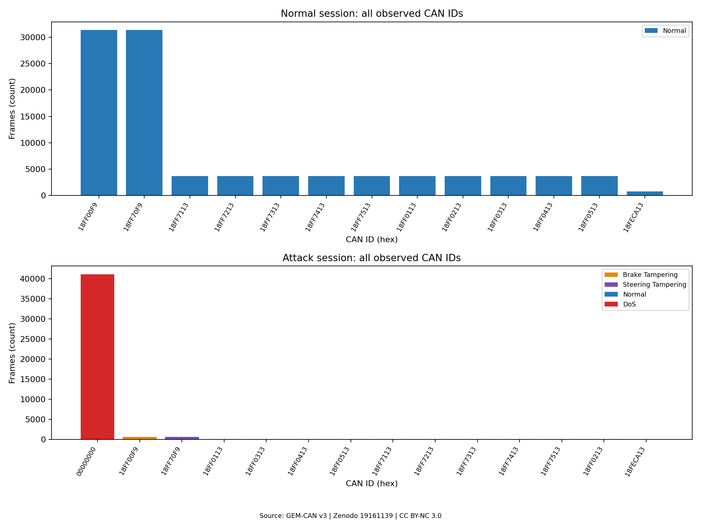
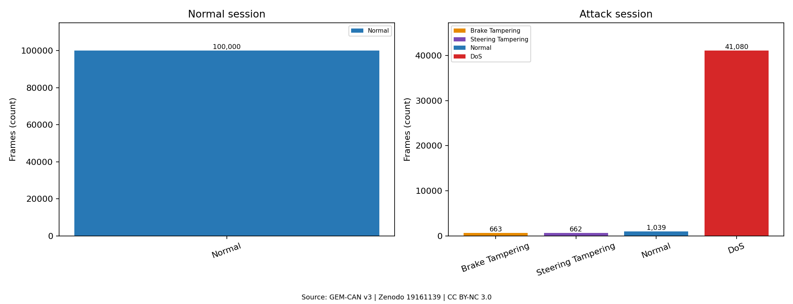

# Lab 03 — GEM-CAN v3 공개 차량 CAN 데이터 분석

공개된 실제 차량 CAN 데이터의 오프라인 통계 분석을 완료했습니다. 직접 차량·물리 ECU 시험 또는 취약점 발견을 수행한 결과가 아닙니다. GNN·머신러닝 모델은 구현하지 않았습니다.

## 출처·버전·이용 조건

- [공식 Zenodo 레코드](https://zenodo.org/records/19161139), DOI: [10.5281/zenodo.19161139](https://doi.org/10.5281/zenodo.19161139).
- 레코드 화면 버전 **v3**, 발행일 2026-03-22, 확인·분석일 2026-11-10. ZIP 이름의 `R2`와 레코드 버전을 구분합니다.
- 제목: GEM-CAN: Real-World CAN-Bus Attack Scenarios on an Autonomous Vehicle for Intrusion Detection.
- 저자: Mahsa Tavasoli, Abdolhossein Sarrafzadeh, Ali Karimoddini, Tienake Phuapaiboon, Milad Khaleghi, Daniel Tobias.
- [공식 API](https://zenodo.org/api/records/19161139)의 `access_right=open`, `metadata.license.id=cc-by-nc-3.0` 확인.
- [CC BY-NC 3.0](https://creativecommons.org/licenses/by-nc/3.0/): 비상업적 공유·변경을 허용하며 출처·라이선스 표시 및 파생물의 변경 표시 등 조건이 적용됩니다. 이 Lab의 그래프·집계는 원본으로부터 생성한 파생 분석물입니다. 원본은 재배포하지 않습니다.

제공자 문서는 GEM e6, 250 kbps CAN, 폐쇄 트랙 및 공격 주입 중 차량 정지를 설명합니다. 이는 제공자의 실험 설명이며 본 Lab에서 독립적으로 검증한 수집 환경이 아닙니다.

## 다운로드와 원본 무결성

사용자 승인 후 공식 파일 3개를 다운로드했습니다. **모두 공식 크기·MD5와 일치**했습니다. 검증 시각·계산한 MD5/SHA-256·ZIP 전체 파일 목록은 [integrity.json](reports/integrity.json), 공식 기대값은 [source-manifest.json](metadata/source-manifest.json)에 있습니다. MD5 비교는 배포 파일과의 일치 확인이며 출처 인증을 보장하지 않습니다.

| 파일 | 실제 bytes | 공식 MD5와 동일한 계산값 |
|---|---:|---|
| GEM_CAN_Dataset_R2.zip | 2,438,377 | `03f7a86ed05da9ab282f2886bf9b3ca3` |
| GEM_CAN_metadata.json | 3,312 | `68aa81594b2a5efdd02206394f72708b` |
| README.md | 7,410 | `0a28f4cb4f852206b5264a9dfa2c1e0a` |

총 2,449,099 bytes. 원본은 `data/raw/`, 해제 자료는 `data/raw/extracted/GEM_CAN_Dataset_R2/`에 보관합니다. 루트 `.gitignore`는 이 Lab의 `data/raw/` 전체를 제외합니다. ZIP 경로 이탈·절대경로·심볼릭 링크를 거부하고 비압축 크기 상한 1 GiB 및 ZIP CRC를 확인했습니다. 원본을 덮어쓰지 않습니다. 포함된 외부 전처리·변환 코드는 실행하지 않았습니다.

ZIP에는 CSV 2개, PCAN TRC·JSON, 내부 README·메타데이터, Python 예제 2개, `.DS_Store` 파일과 디렉터리 항목이 있습니다. CSV 실제 이름은 다음과 같습니다. 정상 파일 이름의 `Labeled`는 대문자 L입니다.

- `GEM_Normal_Driving_Raw_Labeled.csv`
- `GEM_Attack_Scenario_Raw_Labeled.csv`

## 실제 스키마와 timestamp 단위 검증

공통 컬럼은 `timestamp, arbitration_id, dlc, data0, data1, data2, data3, data4, data5, data6, data7, label`입니다. 공격 CSV에만 `Attack_Type`가 있습니다. 정상 CSV의 컬럼 부재를 결측으로 집계하지 않으며 label=0 전체 확인 후 비교용 Normal 범주를 부여했습니다.

- CAN ID는 접두사 없는 16진수 문자열입니다. 정상 CSV는 모두 8자리이며 공격 CSV의 DoS ID는 문자열 `0`입니다. 집계·그래프에서 숫자값을 유지하며 `00000000`처럼 8자리로 표시합니다.
- 정상 CSV의 ID는 모두 11비트 범위를 초과하며 29비트 범위 안입니다. 공격 세션은 값 0인 41,080행과 11비트 범위를 초과한 2,364행입니다. CSV에는 IDE/EFF 플래그가 없어 ID 값만으로 프레임 플래그를 검증한 것으로 보지 않습니다.
- DLC는 전 행 **8**이며 Payload 8개 바이트와 일치합니다. 바이트는 `5`, `0`, `0A` 등 1~2자리 16진수입니다. 십진수로 읽지 않았으며 원본 CSV는 변경하지 않았습니다.
- label은 `0=Normal`, `1=Attack`입니다. 공격 유형 실제 문자열은 `Normal`, `DoS`, `Brake Tampering`, `Steering Tampering`입니다. label과 Normal/공격 유형 간 불일치는 0행입니다.
- **CSV timestamp는 실제로 밀리초(ms)**입니다. 공격 TRC 헤더는 `Time Offset [ms]`, 정상 JSON 키는 `Time Offset (ms)`입니다. 양쪽 모두 CSV 전 행의 timestamp·숫자 CAN ID·DLC·Payload가 원본과 순서까지 일치했습니다(정상 100,000행, 공격 43,444행). 시간 분석은 `Decimal(timestamp) / 1000`으로 초로 변환합니다.
- timestamp 표기는 소수점 이하 0~3자리입니다. 최대 0.001 ms(1 µs) 저장 간격을 표현하지만 실제 시계 정확도는 검증하지 않았습니다. README의 초 단위 설명 및 포함 변환 코드의 `/1000` 처리와 실제 배포 CSV를 혼동하지 않습니다.

## CAN 프레임 필드와 CSV 분석용 컬럼

`arbitration_id`(CAN ID), `dlc`(데이터 길이), `data0`~`data7`(Payload 바이트)은 CAN 프레임에 대응하는 값입니다. CSV는 프레임 전체의 비트 표현이 아니며 IDE/EFF, CRC, ACK 등의 필드를 포함하지 않습니다.

`timestamp`는 CAN 프레임 내부 필드가 아니라 수집 도구가 남긴 시간 정보입니다. CSV 컬럼으로 옮겨졌으며, 이 배포본에서는 원본 PCAN의 밀리초 offset과 일치합니다. `label`과 `Attack_Type`는 제공자가 분석·학습용으로 부여한 주석으로 버스에서 전송되는 값이 아닙니다. `label`은 정상 0 / 공격 1이고 `Attack_Type`는 공격 세션 CSV에만 있습니다. 정상 주행 CSV의 Normal 범주는 전체 label=0 확인 후 분석 코드에서 부여했습니다. 이 주석의 정확성을 차량 상태와 독립적으로 검증한 것은 아닙니다.

## 실제 분석 결과

| 항목 | 정상 주행 CSV | 공격 세션 CSV |
|---|---:|---:|
| 전체 행 | 100,000 | 43,444 |
| 정상 label=0 | 100,000 | 1,039 |
| 공격 label=1 | 0 | 42,405 |
| 고유 CAN ID | 13 | 14 |
| 기존 컬럼의 빈 값·공백 결측 | 0 | 0 |
| 전체 컬럼 동일 중복 (첫 행 제외) | 0 | 21,363 |
| timestamp·ID·DLC·Payload 동일 중복 | 0 | 21,363 |
| 동일 timestamp 반복 (첫 값 제외) | 0 | 21,363 |
| 입력 순서에서 timestamp 역행 | 0 | 79 |
| DLC=8 | 100,000 | 43,444 |
| 첫~마지막 timestamp 차이 (s) | 368.230143 | 30.052250 |
| 행 수 / 위 시간 차이 (frames/s) | 271.569294 | 1,445.615553 |

전체 **143,444행**, 정상 **101,039행(70.437941%)**, 공격 **42,405행(29.562059%)**입니다. 서로 다른 두 세션을 합친 구성비이며 실제 도로 환경의 공격 발생 확률을 뜻하지 않습니다. 결측은 빈 문자열·공백 기준이며 ID·바이트·DLC·label·timestamp 유효성 검사도 전 행 통과했습니다. 중복 제거·행 필터링 없이 모든 관측 행을 사용했습니다.

| 공격 세션 범주 | 행 | 세션 내 비율 (%) | ID |
|---|---:|---:|---|
| Normal | 1,039 | 2.391585 | 11종 |
| DoS | 41,080 | 94.558512 | `00000000` |
| Brake Tampering | 663 | 1.526103 | `18FF00F9` |
| Steering Tampering | 662 | 1.523801 | `18FF70F9` |

### 정상·DoS·데이터 변조 비교

- 정상 주행에서 `18FF00F9`, `18FF70F9`는 각각 **31,383행(각 31.383%)**으로 가장 많습니다. 나머지 ID별 전체 건수와 그룹 내 비율은 [CAN ID 집계](reports/can_id_distribution.csv)에 있습니다.
- DoS 레이블 41,080행은 ID=0과 8바이트 0 Payload만 가집니다. 그중 완전 중복 21,363행이며 동일 행의 최대 출현 수는 6회입니다. 원본 TRC에서도 해당 행이 존재하고 DoS 41,080행 모두 **Tx**, 다른 2,364행은 Rx로 기록되어 있습니다. 송신 시도·로거 중복·버스에서 실제 관측한 프레임의 관계를 독립적으로 확인하지 못했으므로 이 건수를 실제 버스 전달량이나 버스 포화율로 단정하지 않습니다.
- Brake Tampering 663행의 Payload는 `05 00 64 5B 0A 00 FF 00`, Steering Tampering 662행은 `05 00 C5 85 FA FF 7A 00`으로 각 1종입니다. 두 ID는 정상 데이터에도 존재합니다. 정상 세션에서 해당 ID의 Payload는 각각 **745종**, **3,709종**입니다. 이 차이만으로 일반적인 공격 판별 규칙이나 물리적 제동·조향 효과를 입증하지 않습니다.
- timestamp 정렬 후 유형 내 인접 간격 중앙값은 Brake **11.055 ms**, Steering **11.052 ms**, DoS **0 ms**입니다. DoS의 0은 반복 시각의 영향을 받으며 실제 주입 주기로 해석하지 않습니다. 정상 주행 전체 ID를 합친 중앙값은 1.010 ms이며 서로 다른 ID가 섞인 간격입니다.
- 세션 시작 기준 1초 구간의 전체 행 수 최대값은 정상 **283행**, 공격 **3,003행**입니다. 중복과 Tx 기록을 유지한 로그 건수입니다. 각 세션 길이·수집 조건이 달라 원시 건수나 평균 비율의 차이로 공격 효과를 인과적으로 추론할 수 없습니다.

## 공식 설명과 원본의 불일치

1. 공식 README는 공격 CSV 43,443행 / Normal 1,038행을 기재하지만 실제 CSV·TRC는 **43,444행 / Normal 1,039행**입니다. 공격 42,405행과 세 공격 유형별 건수는 문서와 일치합니다. 차이의 원인은 확인하지 못했습니다.
2. README의 timestamp 초 단위 설명과 달리 배포 CSV 숫자는 원본의 ms 값과 전 행 일치합니다. 원본 단위에 따라 분석했습니다.
3. ZIP 내부와 별도 배포 JSON은 서로 다릅니다. DoS `injection_interval_ms`는 내부 1.1 / 외부 1, Brake·Steering은 내부 11,100 / 외부 11입니다. 내부 README는 변조 지속시간 약 89초·간격 11.1초, 외부는 약 27초·11 ms로 설명합니다. 서로 같은 메타데이터로 합치지 않았습니다. 실제 변조 행의 first~last 범위는 각각 **27.361770초**, **27.362356초**이나 중간 공백이 있으므로 연속 주입 시간은 아닙니다.
4. 포함된 변환 예제는 timestamp를 초로 변환하고 direction 컬럼을 남기지만 실제 CSV는 ms 값이며 direction 컬럼이 없습니다. 배포 CSV를 그 코드로 생성한 결과라고 단정하지 않습니다.

## DoS 상세 분석

[DoS 구간 심화 분석](dos-deep-dive/README.md)을 완료했습니다. 초당 기록 수의 노출 시간 보정, 중복 포함·제외 민감도, 정상 ID별 구간 내 간격과 경계를 가로지르는 실제 인접 공백을 구분했습니다. 원본 중복·Tx 기록의 의미와 물리적 영향의 검증 한계도 해당 문서에 기록했습니다.

## 그래프와 집계 파일

그래프는 영어 축으로 글꼴 의존성을 줄였으며 단위·범례·출처·라이선스를 표시했습니다. 두 세션의 시간축은 각각 첫 프레임을 0초로 맞췄습니다. 1초 반개구간 `[k, k+1)`을 사용하고 0건 구간을 보존합니다. 마지막 구간은 부분 관측 구간이며 노출 시간으로 보정한 rate가 아닌 **구간별 로그 행 수**입니다. timestamp 역행이 있어도 시간값으로 구간을 정하며 원본 순서는 변경하지 않습니다. 간격 통계에서만 정렬 사본을 사용합니다.







- [전체 요약·컬럼별 결측·유효성·Payload 다양성](reports/summary.json)
- [시간 구간별 건수](reports/time_bins.csv)
- [CAN ID별 건수·비율](reports/can_id_distribution.csv)
- [DLC 분포](reports/dlc_distribution.csv)
- [범주별 분포](reports/group_distribution.csv)
- [분석 결과 요약](reports/analysis-summary.md)
- [실행 환경 패키지](reports/environment.txt)
- [최종 재실행 비교 검증](reports/validation.json)

## 재현 명령

실행 위치는 **저장소 루트**입니다. Python 3.12 및 인터넷(최초 파일·패키지 다운로드)이 필요합니다. 일반 사용자 권한으로 실행하며 CAN 인터페이스·차량·관리자 권한은 필요하지 않습니다. 이번 실행은 Python 3.12.3 / Matplotlib 3.10.8에서 완료했습니다.

```bash
python3 -m venv labs/03-gem-can-analysis/.venv
labs/03-gem-can-analysis/.venv/bin/python -m pip install -r labs/03-gem-can-analysis/requirements.txt
labs/03-gem-can-analysis/.venv/bin/python labs/03-gem-can-analysis/src/prepare_data.py
labs/03-gem-can-analysis/.venv/bin/python labs/03-gem-can-analysis/src/analyze.py --output /tmp/gem-can-recheck/reports --figures /tmp/gem-can-recheck/figures
```

다운로드는 이번 사용자 승인으로 실행했습니다. `prepare_data.py`는 고정한 공식 목록을 사용하며 기존 파일은 다운로드하지 않고 검증합니다. 부분 다운로드·크기·체크섬 불일치 시 중단하고 해당 파일을 남깁니다. 압축 해제된 기존 파일이 다르면 중단하며 덮어쓰지 않습니다. 검증 후 기존 `integrity.json`도 보존합니다.

최초 분석은 옵션 없이 `reports/`, `figures/`에 생성했습니다. 재실행은 위처럼 **존재하지 않는 새 결과 경로**를 사용합니다. 이미 summary 또는 PNG가 있으면 중단합니다. 기대 결과는 위 행 수·분포, 원본과 전 행 일치 및 그래프 4개입니다. 집계 합계가 각 CSV 행 수와 일치하는지 코드에서 검사합니다. 의존성 설치를 제외한 분석은 로컬 자료만 사용합니다.

## 검증과 한계

- 공식 파일 크기·MD5, ZIP CRC·안전 경로, CSV와 원본 전 행 대조, 집계 행 수 보존을 실제 확인했습니다. 보고한 중복·역행은 원본에도 존재합니다. 새 임시 경로에서 재실행한 집계 5개와 PNG 4개가 최종 결과와 바이트 단위로 일치했습니다. 문서 상대 링크 및 Git 원본 제외도 확인했습니다.
- 원본 로그의 수집 누락·시계 정확도·동일 timestamp의 원인·Tx 프레임의 물리 버스 전달 여부는 확인하지 못했습니다. 중복 삭제 시 다른 통계가 나오므로 이번에는 삭제하지 않았습니다.
- 레이블은 제공자의 정답을 사용합니다. 실제 공격 실행 로그·차량 상태와 대조한 독립적인 정답 검증은 수행하지 않았습니다. 공식 문서가 주장하는 100% 버스 부하·조향 지연·물리적 영향은 재검증하지 않았습니다.
- CAN ID와 Payload를 신호 정의 없이 차량 물리량으로 해석하지 않습니다. 정상·공격의 통계적 차이는 취약점 발견을 의미하지 않습니다.
- Lab 01·02 소스 및 증적은 수정하지 않았으며 Git commit/push를 수행하지 않았습니다.

## 폴더

```text
03-gem-can-analysis/
├── README.md
├── requirements.txt
├── metadata/source-manifest.json
├── src/
│   ├── prepare_data.py
│   └── analyze.py
├── data/raw/                 # 공식 원본·해제 자료, Git 제외
├── reports/                  # 무결성·통계·환경·요약
├── figures/                  # Matplotlib PNG 4개
└── dos-deep-dive/             # DoS 상세 문서·코드·집계·PNG 4개
```
