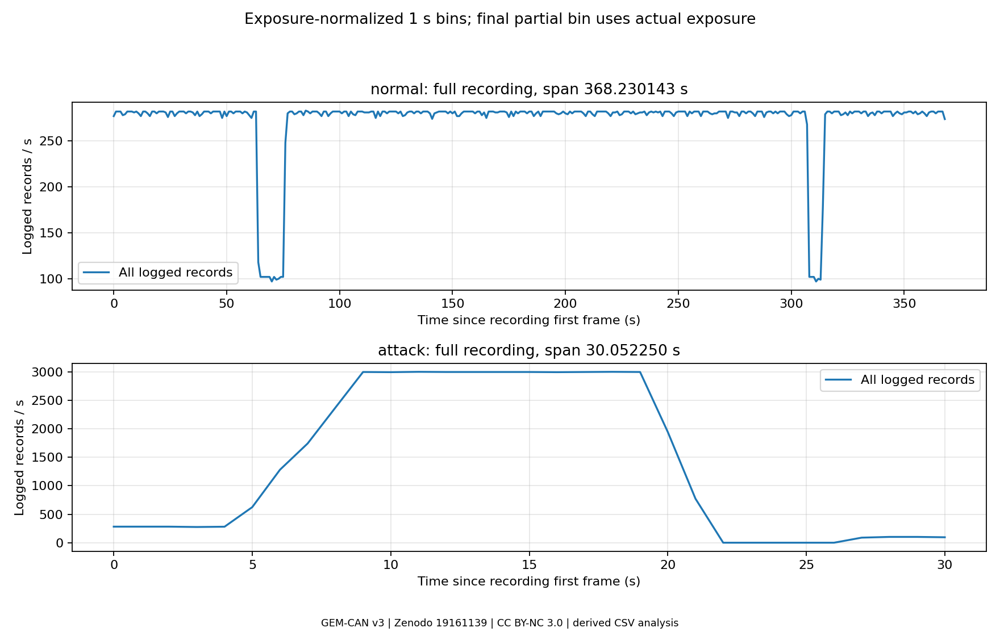
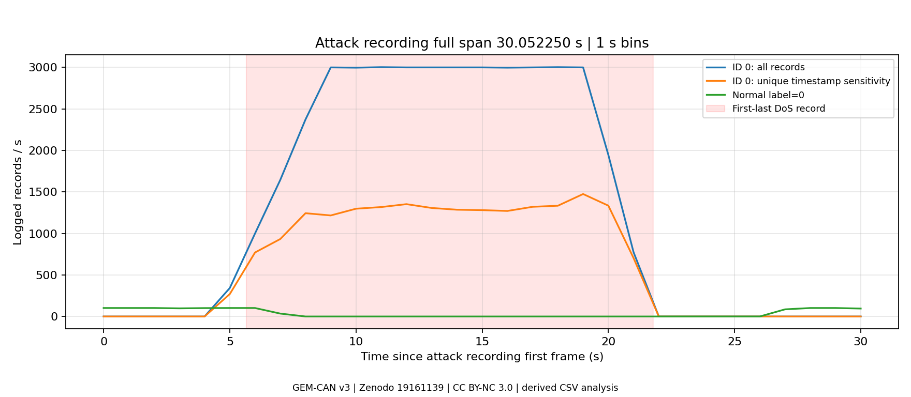
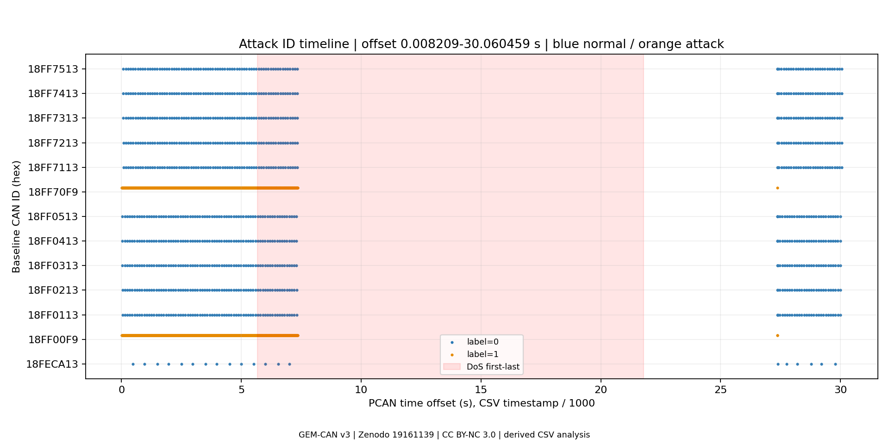
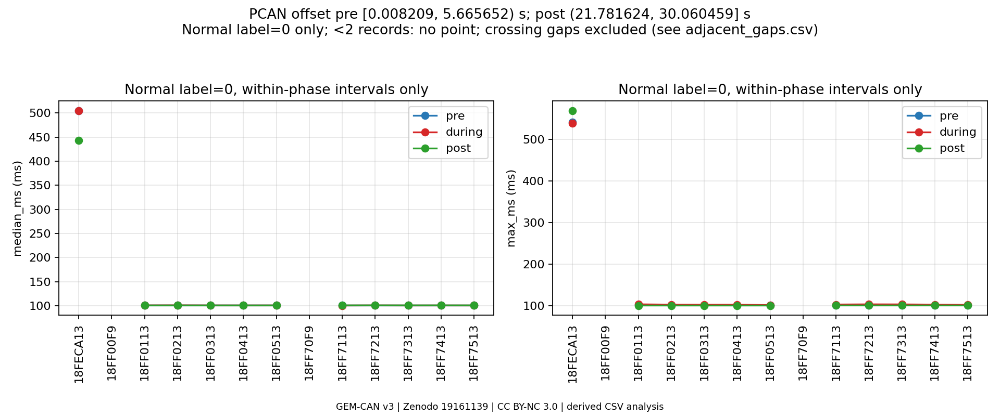

# GEM-CAN v3 DoS 구간 심화 분석

분석일: 2026-11-11. 기존 [1차 분석](../README.md)과 원본을 보존한 후속 오프라인 분석이다. 차량·ECU 실험, GNN·머신러닝 구현은 수행하지 않았다. 아래 수치는 실제 로컬 CSV 및 PCAN 원본을 읽어 계산했다.

## 자료와 시간 단위 검증

출처는 [GEM-CAN v3 / Zenodo 19161139](https://zenodo.org/records/19161139), DOI [10.5281/zenodo.19161139](https://doi.org/10.5281/zenodo.19161139)이다. 데이터 라이선스는 CC BY-NC 3.0이며 이 폴더의 그래프·집계는 원본을 분석한 파생물이다. 원본을 재배포하지 않는다. 별도 배포 README·메타데이터와 ZIP 내부 문서를 각각 읽었다. 파일별 SHA-256 및 실행 환경은 [summary.json](results/summary.json)에 기록했다.

| 근거 | 공식 설명 또는 실제 확인 |
|---|---|
| 별도 배포 `data/raw/README.md` | `timestamp`를 seconds, microsecond resolution으로 설명. PCAN 값은 변경하지 않았다고도 설명 |
| 공격 PCAN TRC 헤더 | Time Offset의 단위를 `[ms]`로 표시 |
| 정상 PCAN JSON | 키 이름이 `Time Offset (ms)` |
| 정상 CSV ↔ JSON | 100,000행의 timestamp·숫자 CAN ID·DLC·Payload가 순서까지 전부 일치 |
| 공격 CSV ↔ TRC | 43,444행이 같은 방식으로 전부 일치 |
| 별도/ZIP 내부 메타데이터 | timestamp 단위 필드가 없으며 `injection_interval_ms`는 공격 설정 설명이다. CSV의 timestamp 단위를 직접 지정하는 필드가 아님 |

**배포 CSV timestamp의 숫자는 밀리초(ms)이다.** 예를 들어 공격 첫 값 `8.209`는 8.209 ms, 즉 0.008209 s이다. 분석에서는 Decimal로 읽은 뒤 정수 마이크로초로 변환하고, 결과에 초(s) 또는 밀리초(ms)를 명시했다. 전 행에서 소수 손실이 없는지 확인했다. 소수점 이하 최대 3자리 ms는 1 µs의 표현 간격이며, 실제 시계 정확도·로그 수집 정확도를 검증한 것은 아니다. README 설명대로 숫자를 그대로 초로 해석하면 지속시간은 1,000배, 초당 빈도는 1/1,000로 잘못 계산된다.

메타데이터의 DoS 설정 간격은 별도 배포본 1 ms / ZIP 내부 1.1 ms이다. 변조 설정도 별도 11 ms / 내부 11,100 ms로 다르다. 설정값을 관측 주기로 대체하지 않았다. 공식 README의 공격 전체 43,443행·Normal 1,038행은 실제보다 각각 1행 작다. 이러한 문서 불일치는 기존 1차 분석에서도 지적한 사항이다.

## 정렬·중복과 분석 방법

| 항목 | 정상 주행 CSV | 공격 세션 CSV |
|---|---:|---:|
| 행 수 | 100,000 | 43,444 |
| timestamp 범위 (ms) | 127,876.661–496,106.804 | 8.209–30,060.459 |
| min~max 관측 시간 (s) | 368.230143 | 30.052250 |
| 원본 순서의 timestamp 역행 | 0 | 79 |
| 동일 timestamp 추가 기록 | 0 | 21,363 |
| 전체 컬럼 완전 중복, 첫 출현 제외 | 0 | 21,363 |
| timestamp·ID·DLC·Payload 중복 | 0 | 21,363 |

두 파일 모두 첫·마지막 timestamp가 min·max와 같지만 공격 CSV 내부는 정렬되어 있지 않다. 간격 계산에서만 정렬한 사본을 사용했다. 원본과 행을 삭제하거나 변경하지 않았다. 중복은 모두 DoS ID 0에 있으며 동일 기록의 최대 출현 수는 6회이다. CSV의 중복·역행은 원본 PCAN에도 존재한다.

- 전체 수집 비교는 `행 수 / (max_timestamp - min_timestamp)`로 계산한다. 관측 양 끝의 차이를 노출 시간으로 쓰는 기술통계이며 장기 발생률 추정치가 아니다.
- 시간별 비교는 각 세션의 첫 프레임을 0초로 맞춘 1초 구간이다. 마지막 부분 구간은 실제 노출 시간으로 나눈다. 서로 다른 수집 세션의 상대시간을 동시 사건으로 연결하지 않는다.
- DoS 경계는 CSV ID 0의 첫·마지막 관측값이다. 공식 README의 반올림 구간이나 메타데이터의 100 ms 레이블 버퍼를 추가 적용하지 않았다. 전: `[0.008209, 5.665652) s`, 중: `[5.665652, 21.781624] s`, 후: `(21.781624, 30.060459] s`. 이 절의 시간은 **PCAN offset**이며 세션 첫 프레임 기준 상대시간과 0.008209 s 차이가 난다.
- 정상 ID는 정상 주행에서 관측된 13종으로 정의한다. 공격 세션에서는 `label=0`만 선택한 통계와 같은 ID의 모든 레이블을 포함한 통계를 분리한다. `18FF00F9`, `18FF70F9`는 공격 세션에서 전부 변조 레이블이므로 정상 메시지로 취급하지 않는다.
- 구간 내 간격은 양 끝 메시지가 같은 구간에 있는 인접 기록만 사용한다. 2행 미만이면 간격 통계는 빈 값이다. p95는 NumPy 선형 보간이다. 구간 경계에 걸친 공백은 별도 [실제 인접 간격](results/adjacent_gaps.csv)에 모두 보존했다.

## 초당 메시지 기록 수

| 세션 | 전체 관측 시간 (s) | 전체 기록/s | 중복 signature 제외 시 기록/s |
|---|---:|---:|---:|
| 정상 주행 | 368.230143 | 271.569 | 271.569 |
| 공격 세션 | 30.052250 | 1,445.616 | 734.754 |

공격 세션의 총행은 정상보다 적지만 초당 기록 수는 약 5.32배이다. 완전 중복 signature를 한 번씩만 센 민감도 비교에서는 약 2.71배다. 이는 중복 처리에 따라 결론의 크기가 크게 달라짐을 보여준다. 주 분석은 중복을 유지하며, 민감도 비교를 정답에 가까운 버스 프레임 수라고 보지 않는다. 정상 주행과 정차 공격 수집의 환경·길이도 달라 이 비율을 공격의 인과 효과로 해석하지 않는다.

| 공격 세션 구간 | 노출 시간 (s) | 전체 기록/s | ID 0 기록/s | 정상 label=0 기록/s | 비제로 ID 전체 레이블 기록/s |
|---|---:|---:|---:|---:|---:|
| DoS 전 | 5.657443 | 280.515 | 0 | 100.929 | 280.515 |
| DoS 중 | 16.115972 | 2,578.746 | 2,549.024 | 10.735 | 29.722 |
| DoS 후 | 8.278835 | 35.995 | 0 | 35.633 | 35.995 |

ID 0 기록이 크게 늘어나는 동안 다른 ID 기록률이 감소했다. 정상 label=0 기록은 전 대비 중 약 89.4% 감소했다. 그러나 DoS 전부터 변조 공격이 있으므로 전 구간을 순수 정상 대조군이라고 부를 수 없다. 후 구간에는 긴 무기록 구간이 포함되어 있어 후 평균도 회복 이후의 정상 주기만 나타내지는 않는다.



## ID 0의 빈도와 시간 변화

DoS ID `0x00000000`은 5.665652–21.781624 s에 41,080행으로, 관측 범위 16.115972 s에서 **2,549.024 기록/s**이다. 모두 Payload `00 00 00 00 00 00 00 00`, 원본 TRC 방향 **Tx**이다. 나머지 2,364행은 Rx이다. Tx 로그를 버스에서 성공적으로 수신된 프레임으로 단정할 수 없다.

중복 21,363행을 제외한 고유 기록은 19,717개, 같은 범위에서 1,223.445 기록/s이다. 정렬 후 DoS 인접 간격 중앙값은 전체 0 ms / 고유 기록 0.995 ms, p95는 각각 1.999 / 2.004 ms, 최대는 2.435 ms이다. 0 ms는 반복 timestamp의 결과이며 무한 전송률을 뜻하지 않는다. 고유 기록 중앙값이 약 1 ms인 것은 외부 메타데이터 설정과 비슷하지만 설정 주기·실제 전달 주기를 검증한 결과는 아니다.

세션 첫 프레임 기준 상대시간의 1초 구간에서 ID 0은 `[5,6)` 343행 → `[6,7)` 1,000행 → `[7,8)` 1,645행 → `[8,9)` 2,373행으로 증가했다. `[9,20)`의 각 1초 구간은 2,997–3,003행이다. `[20,21)` 1,946행, `[21,22)` 773행이며 이후 0행이다. 시작·종료가 들어간 구간은 DoS가 없는 시간도 포함하므로 이 값은 활성 구간만의 주입률과 다르다. 3,000행/s의 평탄부는 중복 기록을 포함한다.



## 정상 CAN ID의 간격과 공백

핵심 변화는 수신이 이어질 때의 중앙 간격 증가보다 **긴 기록 공백**이다. 정상 레이블 기록은 DoS 중에도 초기 173행이 남아 있으며 7.342486 s 이후 다음 정상 기록은 27.370566 s이다. 모든 비제로 ID를 합치면 7.361877–27.369415 s의 20.007538 s 동안 기록이 없다. ID 0은 그 사이 21.781624 s까지 계속 기록되며 그 이후에도 약 5.59 s간 비제로 ID가 재등장하지 않는다. 이는 로그상의 관찰이며 실제 로거 누락·버스 중재·ECU 처리 중 어느 원인인지 분리할 수 없다.

정상 레이블 ID 중 대표 `18FF0113`의 구간 내 중앙 간격은 전 **100.873 ms** → 중 **100.949 ms** → 후 **100.871 ms**로 비슷하다. 그러나 실제 연속 두 기록 7.308358 s와 27.376794 s 사이에는 **20.068436 s**의 공백이 있다. 이 경계 공백을 빼고 중앙값만 보면 통신 단절을 놓친다. 정상 세션의 이 ID 중앙값은 100.891 ms이다.

| 정상 label=0 ID | 전/중/후 행 수 | 전/중/후 중앙 간격 (ms) | 공격 세션 최대 실제 인접 공백 (s) |
|---|---|---|---:|
| 18FECA13 | 11 / 3 / 6 | 504.433 / 504.525 / 443.008 | 20.374643 |
| 18FF0113 | 56 / 17 / 29 | 100.873 / 100.949 / 100.871 | 20.068436 |
| 18FF0213 | 56 / 17 / 28 | 100.874 / 101.103 / 100.874 | 20.068437 |
| 18FF0313 | 56 / 17 / 29 | 100.875 / 100.897 / 100.874 | 20.069096 |
| 18FF0413 | 56 / 17 / 29 | 100.875 / 100.872 / 100.870 | 20.070091 |
| 18FF0513 | 56 / 17 / 29 | 100.875 / 100.899 / 100.874 | 20.069465 |
| 18FF7113 | 56 / 17 / 29 | 100.796 / 100.751 / 100.994 | 20.033753 |
| 18FF7213 | 56 / 17 / 29 | 100.797 / 100.943 / 100.996 | 20.033682 |
| 18FF7313 | 56 / 17 / 29 | 100.797 / 100.797 / 100.995 | 20.036626 |
| 18FF7413 | 56 / 17 / 29 | 100.797 / 100.852 / 100.991 | 20.037167 |
| 18FF7513 | 56 / 17 / 29 | 100.797 / 100.796 / 100.995 | 20.036612 |

나머지 2개 ID `18FF00F9`·`18FF70F9`는 정상 label=0 표본이 없다. 전체 레이블로 계산하면 DoS 중 각 153행이 남아 있으며 실제 최대 인접 공백은 각각 20.008098 s / 20.009248 s이다. `18FF70F9`의 전·중 구간 내 중앙 간격은 11.052 / 11.0415 ms이며 후는 1행이어서 계산할 수 없다. `18FF00F9`의 후 구간은 2행뿐이므로 간격 0.564 ms 하나를 안정된 주기로 해석할 수 없다. 정상 주행 세션의 이 두 ID도 최대 간격이 각각 12.114148 / 12.115304 s여서 정상 세션 자체가 완전히 일정한 트래픽인 것도 아니다.

공식 README의 “21.712초 steering delay” 계산을 같은 선택 방식으로 재현하면 `18FF70F9`의 DoS 전 마지막 5.659017 s와 DoS 종료 후 첫 27.371125 s 차이는 **21.712108 s**이다. 하지만 사이에 DoS 중 기록 153행이 존재한다. 따라서 이 값은 **서로 인접하지 않은 두 시점의 차이**이며 최대 연속 무기록 간격 20.009248 s와 구분해야 한다. [boundary_gaps.csv](results/boundary_gaps.csv)의 `pre_to_post_gap_s`는 이 전~후 선택값이며 실제 인접 공백은 [adjacent_gaps.csv](results/adjacent_gaps.csv)에 있다.





## 공식 논문의 영향 보고와 이번 관찰의 경계

[Tavasoli 외, Data in Brief 66 (2026), 112805](https://doi.org/10.1016/j.dib.2026.112805)의 [저자 소속 대학 저장소 초록](https://digitalcommons.odu.edu/ece_fac_pubs/600/)을 확인했다. 초록은 버스 부하 20% → 100%, DoS 중 약 20초 steering-lock 지연을 보고하고, 공격 중 안전을 위해 차량을 정차했다고 설명한다. 출판사 본문과 대학 저장소 PDF는 이번 웹 접근에서 403으로 열리지 않아 그림·본문의 추가 수치는 독립적으로 확인하지 못했다. 21.7초·구체 경계는 로컬 공식 README의 설명이다. 논문 전체를 검토했다고 표현하지 않는다.

이번에 직접 확인한 것은 ID 0 Tx 기록 급증, 다른 ID의 기록률 감소, 초기 잔존 메시지, 약 20초 인접 기록 공백, DoS 마지막 기록 후 약 5.59초 뒤의 비제로 ID 재등장이다. 이는 통신 가용성 저하와 시간적으로 함께 나타난 기록 패턴이다. 원시 버스 부하 측정 시계열·오실로스코프·액추에이터 상태·차량 움직임 측정을 분석하지 않았으므로 **100% 포화, ECU 내부 지연, 실제 조향 불능이나 차량 물리 반응은 이번 분석으로 입증하지 않는다.** ID·Payload만으로 신호나 물리량을 추정하지 않는다. 부하율 계산에는 프레임 형식·비트 스터핑·오류·중재·성공 전송 여부도 필요하다.

정차 공격 세션과 정상 주행 세션의 차이, 동시 변조 공격, 불확실한 중복 원인·Tx 의미·시계·레이블, 짧은 후 관측 및 일부 작은 표본이 해석상 한계다. 통계적 유의성이나 일반화 성능·취약점 발견을 주장하지 않는다. 재등장은 해당 ID의 기록 재개를 뜻하며 차량 제어의 완전한 회복을 뜻하지 않는다.

## 파일과 재현

- [분석 코드](analyze_dos.py), [원본 검증·DoS 수치·환경](results/summary.json)
- [구간별 기록률](results/phase_rates.csv), [노출 보정 초별 기록률](results/time_rates.csv)
- [13개 ID 전체의 중앙값·p95·최대 간격](results/per_id_intervals.csv)
- [경계 시점 선택값](results/boundary_gaps.csv), [모든 실제 인접 간격](results/adjacent_gaps.csv)
- [재실행·원본 보존 검증](validation.json)

실행 위치는 저장소 루트이며 일반 사용자 권한으로 실행한다. 기존 Lab 03 `.venv`와 다운로드·해제된 CSV·PCAN 파일이 전제 조건이다. 이번 실행 환경은 Python 3.12.3 / NumPy 2.5.4 / Matplotlib 3.10.8이다. 추가 의존성을 설치하지 않았다. 네트워크·CAN 인터페이스·차량·관리자 권한은 필요 없다.

```bash
labs/03-gem-can-analysis/.venv/bin/python labs/03-gem-can-analysis/dos-deep-dive/analyze_dos.py --output /tmp/gem-dos-rerun
```

출력 경로가 이미 존재하면 중단하므로 재실행마다 새 경로를 사용한다. 기대 결과는 summary JSON, CSV 5개, PNG 4개이다. CSV↔PCAN 전 행 대조 및 구간별 전체 행 수 보존을 코드가 확인한다. 결과가 기존 1차 분석 결과를 덮어쓰지 않는다. 이번에 실제 수행한 검증 결과는 validation 파일을 참고한다. Git commit·push는 수행하지 않았다.
