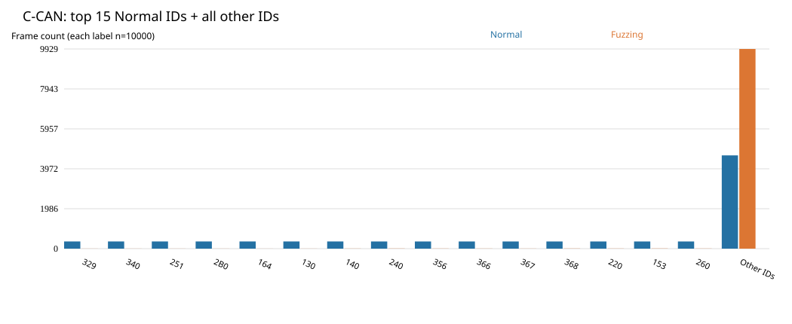
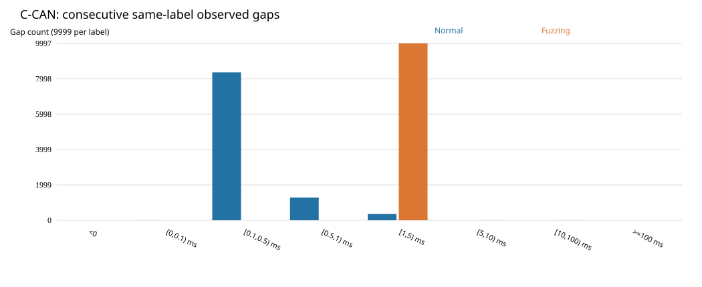

# Lab 04-1 — AutoHack C-CAN 표본 비교

AutoHack 테스트 ZIP의 `Autohack2025_Dataset/Interface/test/autohack_test_both_interface.csv`에서 C-CAN의 `Normal`과 `Fuzzing` 레이블별로 파일 순서상 처음 10,000행을 비교했습니다. 두 표본을 모을 때까지 1,765,382행을 읽었습니다.

## 실제 프레임과 결과

| 레이블 | 원본 행 | Timestamp (s) | CAN ID (16진수) | DLC | Payload |
|---|---:|---:|---|---:|---|
| Normal | 2 | 0.00059 | `329` | 8 | `40 B2 81 14 12 20 00 14` |
| Fuzzing | 1671964 | 357.4183 | `164` | 0 | 빈 값 |
| Fuzzing | 1671972 | 357.41965 | `7EE` | 8 | `88 C9 DD CB 5E 72 EF 3E` |

| 항목 | Normal | Fuzzing |
|---|---:|---:|
| CAN ID 종류 | 108 | 2,033 |
| 고유 Payload 문자열 | 2,773 | 7,999 |
| DLC 0 프레임 | 0 | 1,133 |
| DLC 8 프레임 | 7,926 | 1,129 |
| 같은 레이블의 연속 관측 간격 중앙값 | 0.24 ms | 1.47 ms |

Fuzzing 표본은 더 다양한 ID와 Payload를 포함했습니다. 간격은 C-CAN에서 같은 레이블로 선택된 연속 두 프레임의 Timestamp 차이입니다. 두 표본의 시간대는 서로 다르며 결과의 범위는 선택한 20,000행입니다.



그래프는 Normal 상위 15개 ID를 양쪽에 표시하고, 나머지 ID의 건수를 `Other IDs`로 합산합니다.



## 결과 파일과 재현

- [Normal 표본](results/normal_frames.csv) · [Fuzzing 표본](results/fuzzing_frames.csv)
- [ID별 건수](results/can_id_counts.csv) · [관측 간격](results/intervals.csv)
- [분석 요약](results/summary.json) · [기존 검증 기록](results/validation.json)

원본 ZIP은 `../data/raw/Autohack2025_Dataset.zip`에 로컬 보관하며 Git에서 제외합니다. 재현하려면 별도 작업 복사본의 같은 위치에 ZIP을 두고, 그 복사본의 저장소 루트에서 일반 사용자 권한으로 Python 3.11 이상을 사용합니다.

```bash
python3 labs/04-autohack-analysis/04-1-fuzzing/analyze.py
```

같은 ZIP으로 실행하면 유형별 10,000행과 위 집계가 생성될 것으로 기대됩니다. [스크립트](analyze.py)는 실행 위치와 별개로 스크립트 옆 `results/`에 파생 결과를 다시 씁니다.
